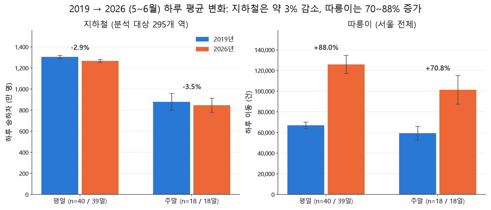
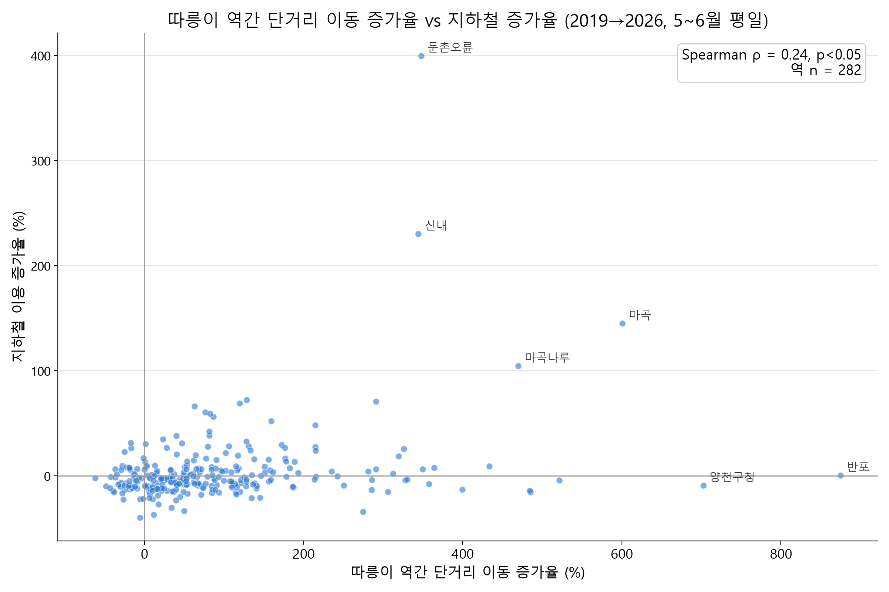
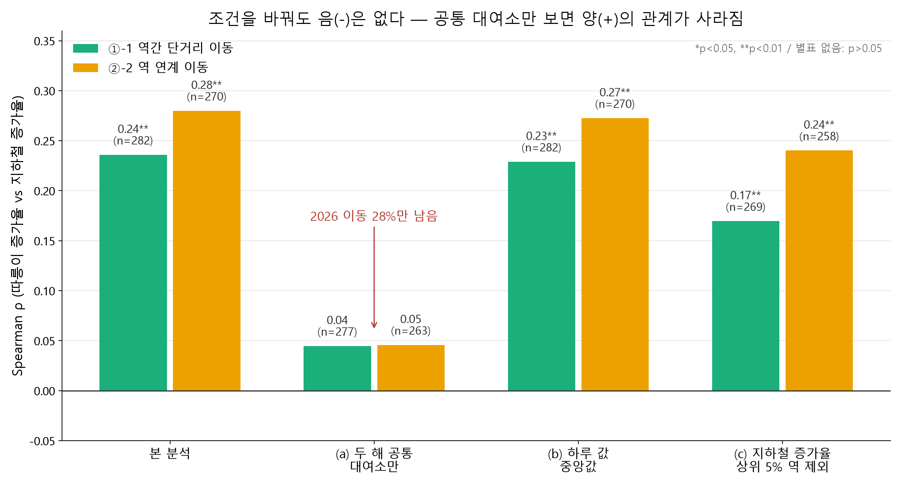

# 따릉이 × 지하철: 2019 vs 2026 서울 데이터 분석

> 7년 사이 두 배가 된 서울 공공자전거 따릉이는 지하철 승객을 빼앗았을까, 아니면 지하철과 함께 가는 수단이 됐을까?

**질문: 따릉이는 지하철의 경쟁자일까, 동반자일까?**

2019년과 2026년의 같은 계절(5~6월) 서울 지하철 승하차 데이터와 따릉이 대여이력을 비교했다. 따릉이 대여소를 지하철역에 연결하고, 따릉이 이동을 역과의 관계에 따라 나눈 뒤, 역별 증가율의 관계를 통계적으로 검정했다.

---

## 역할

| 영역 | 담당 |
|---|---|
| 문제 정의, 가설 설계 | 직접 |
| 분석 기준 결정 (기간, 역 선정, 정제 규칙, 거리 기준, 검정 방법, 예외 처리) | 직접 |
| 결과 검증과 해석 (숫자 확인, 이상치 원인 판단, 견고성 확인 설계, 결론 도출) | 직접 |
| 코드 구현 | [Claude Code](https://claude.com/claude-code) 활용 |

분석 중 나온 예상 밖의 데이터(동명이역, 새 노선, 이용시간 칸 불일치 등)는 단계마다 결과를 확인하면서 처리 기준을 직접 정했다. 그 판단 기록은 [`docs/분석기준_QA.md`](docs/분석기준_QA.md)에 정리했다.

---

## 핵심 결과

1. **따릉이는 지하철의 경쟁자가 아니다.** "따릉이가 많이 는 역일수록 지하철이 덜 늘었다"는 음(−)의 관계가 어떤 조건에서도 유의하게 나오지 않았다.
2. **역별로 따릉이와 지하철이 같이 늘어난 것은 대여소 신설 효과로 보인다(추정).** 두 해 모두 있던 대여소만 보면 그 관계가 사라진다(ρ 0.24 → 0.04).
3. **따릉이는 출근 수단으로 커졌다.** 평일 7~9시 역 근처 반납 비중이 11.5% → 16.4%로 늘었고, 두 해 공통 대여소만 봐도 유지됐다.

| 핵심 숫자 | 2019 | 2026 | 변화 |
|---|---|---|---|
| 따릉이 평일 하루 이동 (서울 전체, 정제 후) | 66,945건 | 125,878건 | +88% |
| 지하철 평일 하루 승하차 (분석 대상 295개 역) | 1,304.9만 명 | 1,267.1만 명 | −2.9% |
| 이용된 따릉이 대여소 | 1,512곳 | 2,777곳 | 1.8배 |
| 평일 7~9시 역 근처 반납 비중 | 11.5% | 16.4% | +4.9%p |

**2019 vs 2026 하루 평균: 지하철은 약 3% 감소, 따릉이는 70~88% 증가**


**역별 따릉이 역간 단거리 이동 증가율 vs 지하철 증가율 (가설①)**


**조건을 바꿔 다시 검정한 결과: 두 해 공통 대여소만 보면 관계가 사라진다**


---

## 가설과 검정

**가설①(경쟁)**: 따릉이 역간 단거리 이동(약 1~2정거장)이 많이 는 역일수록 지하철 이용이 덜 늘었다
**가설②(동반)**: 평일 출근 시간(7~9시)에 역 근처 반납이 몰리고, 따릉이 역 연계 이동이 많이 는 역일수록 지하철도 더 늘었다

| 검정 | H0 / H1 | 방법 · 단위 | 결과 |
|---|---|---|---|
| ①-1 | H0: 역간 단거리 이동 증가율과 지하철 증가율은 상관이 없다 (ρ=0) / H1: 상관이 있다 | Spearman · 역 282곳 | ρ = 0.24 (양, 약함), **p<0.05** → 경쟁 근거 없음, 같이 느는 관계 |
| ①-2 | H0: 역간 이동 많이 는 역 / 적게 는 역의 지하철 증가율 분포가 같다 / H1: 다르다 | 순위합 검정(W) · 역 141 / 141곳 | +0.2% vs −5.1%, **p<0.05** → ①-1과 일관 |
| ②-1 | H0: 2019와 2026의 평일 7~9시 역 근처 반납 비중 분포가 같다 / H1: 다르다 | 순위합 검정(W) · 평일 40 / 39일 | 11.5% → 16.4%, **p<0.05** → 출근 수단 역할 커짐 |
| ②-2 | H0: 역 연계 이동 증가율과 지하철 증가율은 상관이 없다 (ρ=0) / H1: 상관이 있다 | Spearman · 역 270곳 | ρ = 0.28 (양, 약함), **p<0.05** → ①-1과 비슷한 크기, 동네 성장 효과 가능성 |

- 모두 양측검정, 유의수준 0.05. 검정 변수가 모두 정규분포가 아니어서(Shapiro p<0.05) 순위 기반 비모수 검정을 썼다.
- **견고성 확인:**
  - 역간 거리 기준을 1.5km·3km로 바꿔도 결과가 같았다.
  - (a) 두 해 공통 대여소만 쓰면 ①-1·①-2·②-2의 관계가 사라진다(p>0.05). ②-1은 유지된다(p<0.05).
  - (b) 하루 값의 중앙값을 써도, (c) 지하철 급증 상위 5% 역을 빼도 결과는 유지된다(p<0.05).

---

## 분석 흐름

```
데이터 (지하철 승하차 · 따릉이 대여이력 · 대여소 위치)
  → 0단계 파일 점검 · 분석 기간 결정 (4~5월 → 5~6월)
  → 1단계 전처리: 서울 역 295곳 선정, 대여소 → 반경 500m 안 가장 가까운 역 배정,
                  기록 정제, 이동 3유형 분류 (역간 단거리 / 역 연계 / 기타), 역별 집계
  → 2단계 큰 그림 (2019 vs 2026 하루 평균)
  → 3단계 가설① 검정 (+ 거리 기준 민감도, 역간 이동 Top 10 구간)
  → 4단계 가설② 검정
  → 5단계 견고성 확인 (공통 대여소 / 중앙값 / 급증 역 제외)
  → 결론 · 인사이트
```

**전체 분석 과정과 해석은 [`notebooks/walkthrough.ipynb`](notebooks/walkthrough.ipynb)에 있다.** 실행하지 않아도 결과와 그래프를 모두 볼 수 있다. HTML 버전은 [`report/walkthrough.html`](report/walkthrough.html)이다.

---

## 사용 데이터 (서울 열린데이터광장)

| 데이터 | 기간 | 출처 |
|---|---|---|
| 서울시 지하철호선별 역별 승하차 인원 정보 (+ 지하철 노선 위경도) | 2019·2026년 5~6월 | [OA-12914](https://data.seoul.go.kr/dataList/OA-12914/S/1/datasetView.do) |
| 서울시 공공자전거 따릉이 대여이력 정보 | 2019·2026년 5~6월 | [OA-15182](https://data.seoul.go.kr/dataList/OA-15182/S/1/datasetView.do) |
| 서울시 공공자전거 따릉이 대여소 정보 | 2021.01.31 기준, 2026.6월 기준 | [OA-13252](https://data.seoul.go.kr/dataList/OA-13252/S/1/datasetView.do) |
| 서울시 공공자전거 따릉이 대여소별 이용정보(월별) | 2019·2026년 1~6월 (기간 선정 근거) | [OA-15249](https://data.seoul.go.kr/dataList/OA-15249/S/1/datasetView.do) |

- 대여이력의 개인정보 칸(생년·성별·이용자 종류)은 읽지도 쓰지도 않았다. 숫자는 모두 **이용 건수**다.
- **`data/` 폴더는 용량 때문에 저장소에서 제외했다.** 대여이력만 2GB가 넘는다.

### 데이터 받는 법
위 링크에서 아래 파일을 내려받아 다음 위치에 둔다. 파일명은 받은 그대로 둔다.

```
data/
├─ subway/          CARD_SUBWAY_MONTH_201905.csv, 201906.csv, 202605.csv, 202606.csv, 지하철노선위경도정보2.csv
├─ bike_trips/
│  ├─ 2019/         서울특별시 공공자전거 대여이력 정보_1905.csv, _1906.csv
│  └─ 2026/         서울특별시 공공자전거 대여이력 정보_2605.csv, _2606.csv
├─ bike_stations/   공공자전거 대여소 정보(26.6월 기준).xlsx, 공공자전거 대여소 정보(21.01.31 기준).csv
└─ bike_monthly/    공공자전거 대여소별 이용정보_201812_201905.xlsx, _201906_201911.xlsx,
                    서울특별시 공공자전거 대여소별 이용정보(월별)_26.1-6.csv
```

---

## 폴더 구조

```
├─ src/              단계별 분석 코드 (00 → 05), 그래프 내보내기(06), 발표 자료 생성(07)
├─ notebooks/
│  ├─ walkthrough.ipynb   전체 분석 해설 (결과·그래프 저장됨)
│  └─ figures.ipynb       발표용 그래프 셀
├─ outputs/
│  ├─ figures/       그래프 png
│  └─ tables/        단계별 결과 표 (csv)와 실행 로그
├─ docs/             단계별 설명, 분석 기준 · 예상 질문 Q&A
└─ report/           결과 보고서(report.md), 노트북 HTML
```

---

## 실행 방법

```bash
pip install pandas numpy scipy matplotlib pyarrow openpyxl contextily python-pptx jupyter
```

1. 위 "데이터 받는 법"대로 `data/`에 원본 파일을 둔다.
2. 프로젝트 폴더에서 순서대로 실행한다. 각 단계는 결과를 `data/cache/`(parquet)와 `outputs/tables/`(csv)에 저장하고, 다음 단계가 이를 읽는다.
   ```bash
   python src/00_check.py          # 0단계 파일 점검
   python src/00b_check_june.py    # 6월 파일 점검
   python src/01_preprocess.py     # 1단계 전처리 (대여이력 2GB 읽기, 수 분 소요)
   python src/02_overview.py       # 2단계 큰 그림
   python src/03_hyp1.py           # 3단계 가설①
   python src/04_hyp2.py           # 4단계 가설②
   python src/05_robustness.py     # 5단계 견고성
   ```
3. 그래프는 `notebooks/figures.ipynb`, 전체 해설은 `notebooks/walkthrough.ipynb`를 실행한다. 지도 배경은 인터넷 연결이 필요하며, 연결이 없으면 배경 없이 그린다.
4. (선택) `python src/06_export_figures.py`는 그래프를 png로 저장한다.

- 환경: Windows, Python 3.11, 한글 폰트 맑은 고딕

---

## 한계

- **상관이지 인과가 아니다.** "따릉이 때문에"라고 말할 수 없다.
- **같은 사람이 따릉이와 지하철을 갈아탔는지는 모른다.** 두 데이터는 개인 단위로 연결되지 않는다. 결과는 동네 단위 경향이다.
- **따릉이 역간 단거리 이동이 원래 지하철을 탈 사람이었는지는 모른다.** 그래서 "지하철을 대신했을 가능성"까지만 말할 수 있다.
- **이용자 수가 아니라 이용 건수 기준이다.**
- **날씨와 동네 성장(입주·재건축)을 직접 통제하지 않았다.** 하루 중앙값 사용과 급증 역 제외로 일부만 확인했다.
- **공통 대여소 조건은 표본이 크게 줄어든다.** 2026 이동이 27.8%만 남아, 관계가 사라진 데에 표본 감소의 영향도 섞여 있을 수 있다.
- **일부 기준은 임의다.** 역 반경 500m, 2019년 평일 하루 10건 미만 역 제외가 그렇다. 역간 거리 2.5km는 1.5·3km로 바꿔 확인했다.
- **따릉이는 서울에서만 운영되므로 경기 구간 역은 제외했다.**
